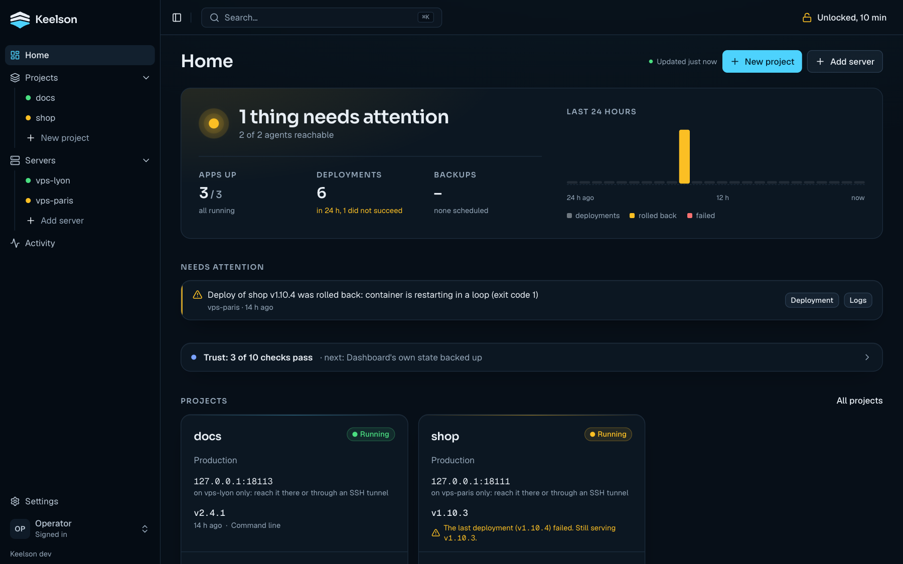
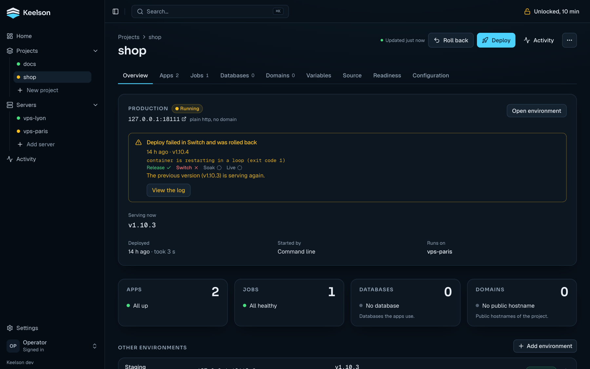
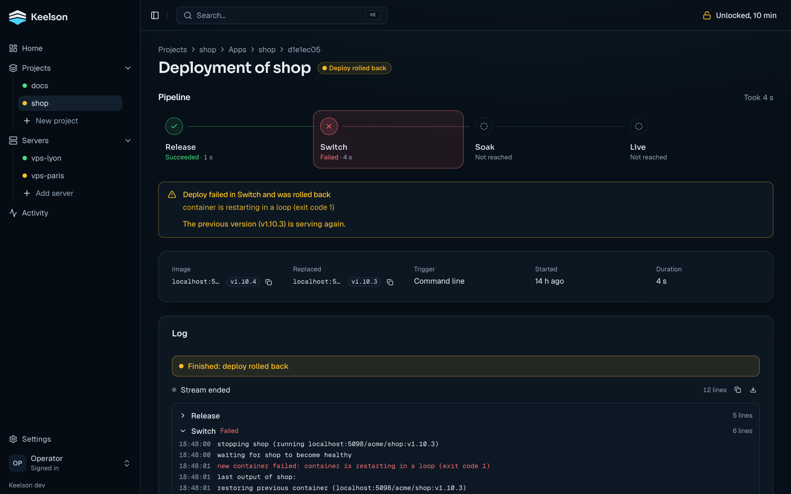
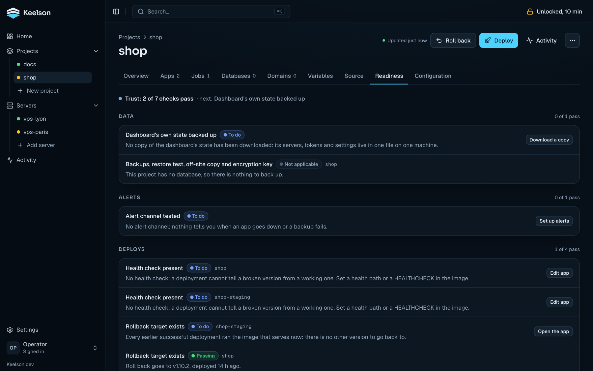
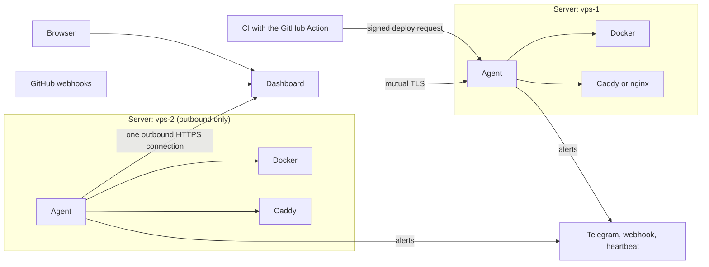

<h1 align="center">
  <picture>
    <source media="(prefers-color-scheme: dark)" srcset="docs/brand/keelson-logo-dark.svg">
    
  </picture>
</h1>

[](https://github.com/0x2u/keelson/actions/workflows/ci.yml)
[](LICENSE)
[](https://github.com/0x2u/keelson/releases)

Keelson deploys and runs containerized apps on your own Docker servers. A small agent on each server deploys, health-checks, rolls back, runs jobs and backs up databases. A web dashboard edits the agents' configuration and shows what they report.

> **Status: pre-1.0, one maintainer.** The core works and is tested. What has and has not been verified on real servers is under [Status](#status).

## See a deployment fail safely

With Docker and Go on your machine, and nothing installed:

```bash
scripts/demo-rollback.sh
```

Version 1 of a site is deployed and serves. Version 2 has a typo in its web server configuration and cannot start. The agent stops trying, shows the server's own error, puts version 1 back and records the deployment as *rolled back*. The script counts the requests that went unanswered during the swap (an in-place deployment has a short gap; blue/green behind Caddy or nginx does not) and fails if version 1 is not serving at the end.

## Screenshots

| | |
|---|---|
|  |  |
| Home: what needs attention, the projects, the databases. | A project: its environments, what serves, the last deployments. |
|  |  |
| A failed deployment: where the pipeline stopped and what still serves. | Readiness: backups, a tested restore, alerts and a way back, with a fix for each check. |

## Concepts

| Term | Meaning |
|---|---|
| **Server** | A machine with Docker and a Keelson agent. A laptop can connect as a server that only builds. |
| **Agent** | The `keelson-agent` binary on a server: deploys, health-gates, rolls back, runs jobs and backups, sends alerts. |
| **Dashboard** | The web application that configures and observes all agents. One operator signs in. |
| **App** | One deployable container: an image, its environment, its port or domains, its health check. |
| **Environment** | A label on an app within a project: `production`, `staging`, `pr-12`. |
| **Project** | A group of apps (with their jobs and databases), possibly across servers: one site and its environments. |

## Quick start

A step-by-step version of this section, with what to expect at each step, is in [Getting started](docs/getting-started.md).

You need a Linux server for the dashboard (Docker with the compose plugin 2.24 or newer) and a Linux server for your apps (systemd, amd64 or arm64, [Docker installed](https://docs.docker.com/engine/install/), outbound HTTPS to the dashboard). They can be the same machine to try it out. For real use, give the dashboard its own server, since it holds the credentials of every agent.

Servers need Linux with systemd and Docker Engine. Debian 12 and 13 are tested; other distributions are not verified, and SELinux-enforcing hosts, rootless Docker and podman are not supported. The agent is built for amd64 and arm64. Its tests, including the ones against a real Docker engine and a deployment that fails and rolls back, run on both architectures in CI (GitHub-hosted amd64 and arm64 machines); only arm64 has been run on a real server so far. The [MCP server](docs/mcp.md) is not published to npm, so you build it from source. A server that connects out is updated with a command shown on its Update page (there is no button); a server added over SSH has a wizard there. Updating the dashboard is one command, see [Upgrading](docs/hosting.md#upgrading).

**1. Install the dashboard.**

```bash
curl -fsSL https://github.com/0x2u/keelson/releases/latest/download/install.sh | sudo sh -s -- --domain keelson.example.com
```

With `--domain` (its DNS record must already point at the server), a Caddy in front gets the certificate. Without it the dashboard listens on `127.0.0.1:3000` only. The script prints the address and a one-time **setup token**. Open the address, enter the token, choose the admin password and **download the recovery file**. Options are in [Hosting](docs/hosting.md).

**2. Connect a server.** *Servers → Add server → Connect with one command* shows a command to run on the server:

```bash
curl -fsSL https://keelson.example.com/install | sudo sh -s -- --code <one-time code> --name vps-1
```

The agent installs itself and opens one outbound HTTPS connection to the dashboard. It needs no inbound port, certificate or firewall rule, and you type no SSH login into a web form. The server shows up as online. To serve an app on a public domain, the server also needs a Caddy dedicated to Keelson ([Reverse proxy](docs/reference/proxy.md)). Without a proxy, apps are published on a local port.

**3. Create a project.** *Projects → New project* offers two ways in. The first needs nothing else:

- **From an image** (no GitHub): type an image with its tag (`traefik/whoami:v1.10.3`), choose the server and the container port, optionally add a domain and variables, review, and press *Create the project and deploy now*. Without a domain the app gets a port on the server (`127.0.0.1:8100`), which you open on the server or through an SSH tunnel.
- **From a repository** (GitHub, optional): under *Settings → Integrations*, press **Connect GitHub**. The dashboard creates a private GitHub App with minimal permissions, you approve it once and install it on your repositories. GitHub calls the dashboard back over https, so this needs the `--domain` from step 1 (Integrations says how to add one to an install without it). Then pick a repository, the server and a domain. Keelson detects the Dockerfile, the port and the health check (a repository without a Dockerfile can use a [build preset](docs/reference/builds.md#build-presets-no-dockerfile-in-the-repository)), writes the app into the server's configuration, builds the image on the server and deploys it. From then on it deploys each push and can preview pull requests.

You can also write an app into the server's configuration by hand and deploy it by tag, from the dashboard or from CI with the [GitHub Action](docs/github-action.md).

**4. Deploy.** Push to the linked branch with *Deploy each push* on, or press **Deploy** on the project and choose a commit. The deployment page shows the pipeline *Source → Build → Release → Switch → Soak → Live* as it runs, and what still serves if something fails.

**5. Roll back.** **Roll back** on the app redeploys the most recent successful version that is not the one serving. **Promote** deploys the exact registry image (by digest) that serves in one environment to another, when both apps use the same image repository. It does not apply to an image Keelson built on the server.

## What the configuration looks like

The desired state of a server is one YAML file, optionally split per project. The dashboard writes it and you can also edit it by hand; unknown keys and other problems are reported with their line. This example is complete and valid: an app behind Caddy with a health gate, a soak, previews, a verified backup before each migration, and a nightly job.

```yaml
proxy:
  acme_email: ops@example.com

notifications:
  telegram: {bot_token_file: /etc/keelson/telegram-token, chat_id: "-1001234567890"}

apps:
  - name: shop
    project: shop
    environment: production
    image: ghcr.io/acme/shop
    env_file: /srv/shop/.env
    domains: [www.example.com]
    port: 3000
    health_path: /api/health            # must answer 2xx before traffic switches
    soak: 60s                           # watch the new version this long; go back if it fails
    release:
      steps:
        - {name: backup, backup: shop}  # a failed backup stops the deployment
        - {name: migrate, container: {command: [pnpm, exec, prisma, migrate, deploy]}}
    previews:
      domain: pr-{pr}-shop.example.com  # one environment per pull request

databases:
  - name: shop
    host: 127.0.0.1
    database: shop
    user: shop
    password_file: /etc/keelson/db-shop # secrets stay in files on the server
    backups:
      schedule: "0 3 * * *"
      recipients: ["age1ql3z7hjy54pw3hyww5ayyfg7zqgvc7w3j2elw8zmrj2kg5sfn9aqmcac8p"]   # public key: the agent cannot read its own backups
      destinations: [{local: {dir: /var/backups/keelson}}]

jobs:
  - name: daily-report
    schedule: "0 7 * * *"
    http: {url: http://127.0.0.1:3000/api/cron/daily-report, bearer: {app: shop, env: CRON_SECRET}}
```

The full reference is [Configuration](docs/reference/configuration.md) and the pages it links to. More examples are in [`docs/examples`](docs/examples).

## Features

**Deployments**
- Health-gated deployments with automatic rollback, in place or blue/green behind Caddy or nginx. After the switch a *soak* watches the new version and puts the old one back if it turns bad.
- Release steps before the switch: a host command, a command in a throwaway container (migrations), or a verified encrypted database backup that aborts the deployment if it fails.
- Previews (Caddy only): once an app has a `previews:` template in its configuration (written in the YAML editor), each pull request from the same repository gets its own environment on its own domain. It is removed when the pull request closes, or at its TTL or the cap.
- Builds on the server that runs the app, or on another server or a connected laptop, within memory and CPU limits. Nothing is pushed to a registry. Presets for Next.js, Node.js, Vite and static sites cover repositories without a Dockerfile.
- Scheduled jobs (an HTTP call, a host program, a one-off container) with run history, overlap protection, time zones and failure alerts.

**Data**
- PostgreSQL: declare an existing server, or have the agent create one container per server with a database and a role per app. Scheduled `pg_dump` backups are read back and verified, encrypted with [age](https://age-encryption.org) to keys the agent never holds, and stored locally or in S3-compatible storage with retention.
- Guided restore into a new database, a restore test that compares row counts, and a key check. A per-project readiness checklist shows which of these you have actually done.

**Operations**
- Configuration from forms or a YAML editor, with validation, diff and versions. The agent applies it without a restart and refuses a change that would orphan a running app unless you confirm.
- Telegram and webhook notifications for failed or rolled-back deployments, apps down, failed jobs, disk and memory, sent by the agent itself so they still work when the dashboard is down. The Telegram and webhook secrets are files you create on the server. An optional heartbeat pings a URL you choose, so an outside service can alert you when the server goes silent.
- Caddy with automatic TLS for apps, static sites, redirects and your own certificates (static sites, redirects and certificates are set in the YAML editor); an nginx driver for hosts that already run nginx (install the agent over SSH or by hand with `--nginx`; the one-command connected install does not set it up); a domains wizard with Cloudflare DNS and live DNS, proxy and HTTPS checks ([serving apps on a domain](docs/reference/proxy.md#serve-apps-on-a-domain)).
- Environment variables edited in the dashboard without SSH, write-only once saved.
- Live logs, container statistics and an activity feed across servers.
- A Prometheus `/metrics` endpoint on every agent (apps up, last deployment, jobs, backup age, restore proofs) with tested example alert rules ([Metrics](docs/reference/metrics.md)).

**Access**
- Two-factor sign-in (TOTP, recovery codes, passkeys), revocable sessions, an audit log, an optional IP allowlist, secrets encrypted at rest.
- Scoped, expiring API tokens and an [MCP server](docs/mcp.md) so an AI assistant can read your servers and, if you allow it, deploy and roll back.

Not every feature has been verified on a real server. See [Status](#status) and [Known limits](docs/limitations.md).

## How it works



The agent is one static Go binary per server. It talks to the local Docker engine, drives Caddy or nginx, and keeps its configuration (a YAML file), history and statistics on the server. Health checks, rollbacks, backups and alerts all run in the agent, so the dashboard can be switched off without stopping your sites. A server the dashboard reaches directly can also keep taking CI deploys through the GitHub Action. A server that connects out cannot, because it has no address for CI to call.

The dashboard reaches an agent in one of two ways. Either the agent dials out to the dashboard (the default, so nothing listens on the server), or the dashboard connects to the agent over mutual TLS. Both carry the same API.

CI can call a directly reachable agent with the GitHub Action, without going through the dashboard. The Action needs the agent's address, its deploy secret and its token, which you read on the server, and it has no automated test beyond ShellCheck. Alternatively the dashboard's GitHub App builds and deploys each push without a CI workflow. Builds run on a server's own Docker engine. The image is tagged locally with the commit and, when built elsewhere, moved to the server that runs it.

Secrets are write-only: once saved, a value is never shown again, logged or returned by the API. More in [Architecture](docs/architecture.md).

## When to pick something else

- Coolify, Dokploy, CapRover and Dokku are broader. They offer catalogues of one-click apps and databases, and several support Docker Compose or several users. Keelson has none of that.
- Dokku and CapRover fit best if you want a Heroku-style `git push` workflow.
- Kamal deploys over SSH from your machine or CI, with no dashboard and no agent left on the server. If that is enough for you, it has less to run than Keelson.
- Keelson assumes one operator, manages Docker hosts only (no Kubernetes or Swarm), uses PostgreSQL as its only database engine, and has build presets only for Node.js and static sites. Any other stack needs a Dockerfile.
- Keelson fits if you want each server's agent to own deploys, rollbacks and backups, with a dashboard on top that you can lose without losing the sites.

## Status

Keelson is pre-1.0, developed by one maintainer and used on its author's own servers. Expect rough edges and breaking changes until 1.0.

- The agent, the dashboard and the MCP server have automated test suites, including tests against a real Docker engine. Installing, connecting, building, deploying and the blue/green switch have been run on real servers on Debian 12 and 13. Rollbacks, backups and restores, and previews are covered by tests and rehearsals but have not all been run end to end on a production server. Previews in particular have not been run from a real GitHub pull request.
- Not yet verified on a real server: Linux distributions other than Debian, amd64 hosts (tested in CI on amd64 machines), certificate renewal by ACME (issuance was verified on one server), GitHub Enterprise Server, and the S3 destination against providers other than MinIO.
- The list of known limits is in [Known limits](docs/limitations.md).

## Documentation

The [documentation index](docs/README.md) lists every page. Good starting points:

| | |
|---|---|
| [Getting started](docs/getting-started.md) | Install, connect a server, deploy a first app |
| [Hosting the dashboard](docs/hosting.md) | Install, environment variables, backup, reverse proxy, GitHub integration, hardening |
| [Architecture](docs/architecture.md) | Components, state, how servers are reached |
| [Reference](docs/README.md#reference) | The agent: configuration, deployments, builds, previews, proxy, jobs, databases, notifications, API, security |
| [Moving a running site](docs/migrating.md) | Bringing an existing site into Keelson |
| [Examples](docs/examples) | Apps files to adapt: a Next.js site with PostgreSQL, a site behind Caddy, previews, build presets |
| [Known limits](docs/limitations.md) | What is not supported or not verified |
| [Development](docs/development.md) | Building and testing each component |
| [Contributing](CONTRIBUTING.md) | How to propose and submit a change |
| [Security](SECURITY.md) | Supported versions and how to report a vulnerability |
| [Changelog](CHANGELOG.md) | What changed in each version |

## License

[MIT](LICENSE)
