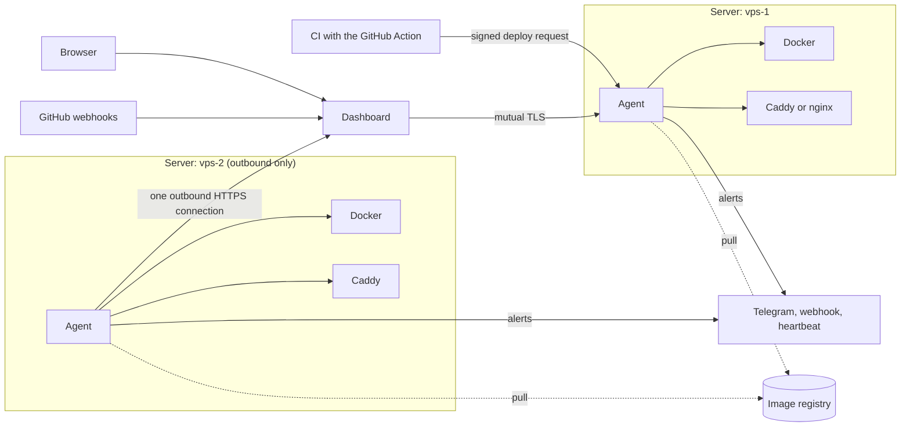

# Architecture

Keelson has two parts: an agent on every server that does the work, and a dashboard that edits configuration and shows what the agents report. Deploys, health checks, rollbacks, backups and alerts all run in the agent, so the dashboard can be switched off without breaking a site.

## Components

| Component | Runs on | Role |
|---|---|---|
| **Agent** (`agent/`) | Every managed server | One static Go binary. Talks to the local Docker engine; deploys images, health-gates and rolls back, switches traffic through Caddy or nginx, runs scheduled jobs and backups, keeps its configuration, history and metrics locally, and sends alerts itself. [Reference](./reference/agent.md). |
| **Dashboard** (`dashboard/`) | A server of its own, separate from the sites it manages | The web interface over all agents: projects, servers, deployments, logs, databases, configuration. Holds the credentials of the agents. A deploy does not need it. [Dashboard](./dashboard.md), [Hosting](./hosting.md). |
| **GitHub Action** (`action/`) | CI | A composite action that sends a signed deploy request straight to an agent. [GitHub Action](./github-action.md). |
| **MCP server** (`mcp/`) | The operator's machine | A client of the dashboard's API for AI assistants. [MCP](./mcp.md). |

Anything that touches data or Docker (SQL, exec, logs) runs on the agent and is relayed back, so database ports are never exposed.

## What the agent does on its own

- A CI job calls an agent directly when it is reachable, never through the dashboard.
- Health checks, rollback and alerts start in the agent.
- Backups go to the destinations you declare, S3-compatible storage included, and are encrypted with keys the agent never holds.
- Each agent can send a heartbeat to an external dead-man switch, so a dead server or a lost link is noticed.
- The dashboard-to-agent API is versioned (`/v1`), so an updated dashboard still talks to an older agent.

An agent with access to the Docker socket is root-equivalent, so requests are signed, it is read-only unless you enable more, and every change goes in an audit log. See [Security model](./reference/security.md).

## How a server is reached

- **The agent connects out** (default). The agent opens one outbound HTTPS connection to the dashboard and the dashboard sends its requests down it. No inbound port, certificate or firewall rule is needed, and it works behind NAT. [Agents that connect out](./reference/relay.md).
- **The dashboard reaches the agent.** The agent exposes one HTTPS API: mutual TLS for the dashboard, HMAC-signed requests for CI and for every change. It can sit on a private network (WireGuard, Tailscale), be public behind mutual TLS, or be reached through a tunnel. [Servers](./reference/servers.md).

Both transports carry the same API.

## State

- **Desired state** is a YAML file on each agent ([Configuration](./reference/configuration.md)): what runs, how it is built, its jobs, databases and proxy. The dashboard edits it through the agent's API, which validates it, writes it atomically, keeps the last 100 versions and applies it without a restart. You can still edit the file by hand.
- **History and runtime state** (deployments, job runs, previews, replay protection, recent stats) live in SQLite next to the agent. The core needs no external database.
- **The dashboard** keeps only its own data: the server registry (encrypted), second factors, sessions, its audit log and the integrations. Nothing about sites, deployments or databases lives there, so losing it means re-adding servers, not losing sites.

## Technology choices

| Topic | Choice | Reason |
|---|---|---|
| Agent language | Go | A static binary, goroutines for long-lived streams, low idle memory. The workload is I/O-bound. The Docker client is a thin wrapper over the engine socket using the standard library instead of the official SDK, which avoids a dependency tree and keeps the read-only guarantee in one file. |
| Dashboard stack | Next.js, TypeScript, React | The agent API is the only contract between dashboard and agents. |
| Reverse proxy | Caddy, managed by the agent (nginx supported) | Automatic TLS and a runtime admin API, so routes change without file templating or reloads. |
| State | Apps file and SQLite on each agent | See above. |
